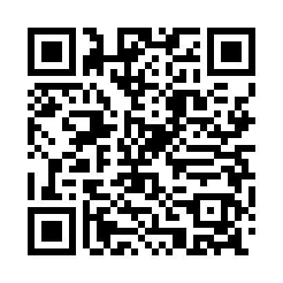

[Português](README.md) · [English](README.en.md) · [Español](README.es.md) · [Français](README.fr.md) · **简体中文** · [日本語](README.ja.md) · [Italiano](README.it.md) · [Deutsch](README.de.md)

<picture>
  <source media="(max-width: 640px)" srcset="docs/assets/hero-mobile.png">
  
</picture>

# BJJ-Cold-Wallet

<a id="testing"></a>

## 🧪 钱包处于测试阶段

**BJJ-Cold-Wallet 正处于测试和开发阶段**。我们需要社区帮助验证应用和硬件流程、发现问题并改善使用体验。

**欢迎参与测试！** 请测试初始设置、蓝牙连接、同步，以及冷钱包上的交易审核和签名。通过 [GitHub 上的 BJJ-Wallet 组织](https://github.com/bjjwallet)分享问题和建议，并注明手机型号、应用及固件版本和复现步骤。

请优先使用测试网络和专门创建的测试钱包。切勿在报告、截图或日志中分享种子、私钥、PIN 或 Transaction Phrase。

**开发者打造、面向开发者的冷钱包，向所有人开放。**

基于 ESP32-S3 的硬件钱包，配备触摸屏，在设备上批准转账，通过 **Bluetooth Low Energy（蓝牙低功耗）** 与 Android 和 iOS 配套应用通信。

<p align="center">
  
  
  
</p>

## 👋 关于我们

我们是 **BJJ-Wallet**，一群致力于通过低成本硬件、开源软件和知识共享，让冷钱包更易获得的开发者。

**BJJ-Cold-Wallet** 将这一想法落地：社区可以研究、制作和改进的实用钱包。我们希望每个人都能了解保护其资产的设备上究竟运行着什么。

我们的原则是可及性、透明度、安全工程和协作。欢迎开发者、创客、设计师和测试者阅读代码、讨论决策、报告问题，共同改进项目。

访问 [GitHub 上的 BJJ-Wallet 组织](https://github.com/bjjwallet)。

[💚 支持 BJJ-Cold-Wallet](#support-project)

## 📱 移动应用

**BJJ-Cold-Wallet** 配套应用支持 Android 和 iOS。它通过蓝牙连接钱包，同步账户观察所需数据，查询余额、准备转账，并广播硬件签名的交易。

转账流程：

1. 用户在应用中选择网络、资产、收款人和金额。
2. 应用通过蓝牙向冷钱包请求签名。
3. 冷钱包显示转账详情，并要求在设备上确认。
4. 硬件签名后将结果返回应用。
5. 应用验证签名，通过相应网络的 API、RPC 或其他接口提交已签名数据。

**种子和用于支出的私钥保留在冷钱包中。应用运行钱包时不会索取或导入种子。** 应用会处理访问凭据；Monero 只读观察模式可能将私有查看密钥保存在加密保险库中。该密钥可以查看交易，但不能授权支出。

当前目录包含 **23 个网络、86 种资产：23 种原生币和 63 种代币**。涵盖 Bitcoin、Ethereum 及 EVM 网络、Solana、Cardano、TRON、XRP Ledger、TON、Sui、Stellar、Litecoin、Dogecoin、Bitcoin Cash、Dash、eCash 和 Monero。当前固件的 Monero 流程使用 **stagenet**。各网络和代币的完整矩阵见应用 README。

应用采用 **Kotlin Multiplatform 和 Compose Multiplatform**，结合 Android 与 iOS 原生集成。

➡️ **[了解移动应用：架构、语言、库、网络与构建](app/README.zh.md)**

## 🔐 硬件

BJJ-Cold-Wallet 使用带电容触摸的 **LCDWIKI ES3C28P** 开发板，基于 **ESP32-S3**，配备 **16 MB Flash**、**8 MB PSRAM** 和 **2.8 英寸 IPS 屏幕**。屏幕原生分辨率为 240 × 320；当前界面为 320 × 240 横屏。规格见[制造商文档](https://www.lcdwiki.com/2.8inch_ESP32-S3_Display)。

固件采用 **C/C++ 与 ESP-IDF**、**LVGL** 界面和用于 Monero 签名的 **Rust** 库。密码学集成包含来自 Trust Wallet Core 4.4.2 的 **TrezorCrypto**，项目记录了版本和来源。

冷钱包控制手机访问、显示审批详情并完成签名。在发行应用中，USB 供电，蓝牙承担应用通信。Wi-Fi 和 microSD 由固件禁用。

### 🛒 开发板与外壳

- **[购买开发板——推荐 AliExpress 商品链接](https://pt.aliexpress.com/item/1005010470966979.html)**。请核对 **ES3C28P 触摸屏**版本；ES3N28P 不带触摸。
- **[3D 打印外壳——推荐 Printables 参考模型](https://www.printables.com/model/1188149-enclosure-for-esp32-s3-touch-lcd-2)**。打印前核对开发板尺寸、固定方式和连接器开孔；本项目尚未验证该模型的机械兼容性。

➡️ **[了解硬件：开发板、TrezorCrypto、库、固件与安装](hardware/README.zh.md)**

项目仍在开发中。请参阅[签名测试结果与限制](app/docs/all-assets-signing-2026-11-21.md)、[代码规范](docs/CODE_STYLE.md)以及[应用](app/LICENSE)和[硬件](hardware/LICENSE)许可。

<a id="support-project"></a>

## 💚 帮助这个想法延续下去

我们希望通过实惠的硬件和开源代码，让冷钱包惠及更多人。您的捐助将支持 BJJ-Cold-Wallet 持续开发，让这个想法延续下去。

**目前，我们需要帮助支付应用商店的开发者注册费用，以发布 Android 和 iOS 应用。**

### 捐助前请选择网络

| USDT · Ethereum | USDT0 · Polygon |
|:---:|:---:|
|  |  |
| 网络: **Ethereum** | 网络: **Polygon** |

两个二维码仅包含同一个地址。发送前，请在钱包中选择标明的代币和网络。

**捐助地址**

在 GitHub 上，使用下方代码块角落的复制按钮。两个网络使用相同地址。

```text
0x142f6f4230934c5555772e4de1E8E39E1105CB2b
```

感谢您支持开放开发。
